<h1 align="center">Production-Grade GitOps-Driven Microservices</h1>

<p align="center">This repository presents the project. The source code is private and available on request.</p>

<p align="center">
  
</p>

<p>
  
  
  
  
  
  
</p>

Private Amazon EKS for **Online Boutique**: Terraform owns the platform, Argo CD owns the shop, and metrics, logs, and traces sit on their own public hostnames.

| Item | Detail |
| --- | --- |
| **Cloud** | AWS `us-east-1` |
| **Cluster** | Amazon EKS 1.34 (`terraform-cluster`), private API, two node groups |
| **Delivery** | GitHub Actions → GHCR → Argo CD + Image Updater |
| **Ingress** | Kubernetes Gateway API → two internet-facing ALBs |
| **Domain** | `oliver14.com` (existing ACM wildcard) |
| **IaC** | Terraform, 21 ordered stacks, encrypted S3 remote state |
| **Observability** | Prometheus, Grafana, Alertmanager → Slack, Jaeger, ECK |
| **Status** | Torn down — AWS stacks were destroyed to stop idle cost. Screenshots and runbooks remain |

**Stack:** Terraform · Amazon EKS · Kubernetes Gateway API · AWS Load Balancer Controller · External DNS · Argo CD · Image Updater · GitHub Actions · GHCR · Trivy · Prometheus · Grafana · Alertmanager · Jaeger · Elastic Cloud on Kubernetes · Cluster Autoscaler · HPA · ElastiCache

The public hostnames below do **not** resolve today. Proof of the running platform is in [sections 7–9](#7-continuous-integration) and [section 15](#15-evidence-from-the-running-platform).

---

## Contents

1. [Overview](#1-overview)
2. [Objectives](#2-objectives)
3. [Platform architecture](#3-platform-architecture)
4. [Application architecture](#4-application-architecture)
5. [Infrastructure as code](#5-infrastructure-as-code)
6. [Networking, DNS, and TLS](#6-networking-dns-and-tls)
7. [Continuous integration](#7-continuous-integration)
8. [GitOps continuous delivery](#8-gitops-continuous-delivery)
9. [Observability](#9-observability)
10. [Autoscaling and reliability](#10-autoscaling-and-reliability)
11. [Security posture](#11-security-posture)
12. [Repository layout](#12-repository-layout)
13. [Public hostnames](#13-public-hostnames)
14. [Operations](#14-operations)
15. [Evidence from the running platform](#15-evidence-from-the-running-platform)
16. [Design notes](#16-design-notes)

---

## 1. Overview

The project is a production-shaped platform around Google's **Online Boutique** — a polyglot shop (catalog, cart, checkout, payment, shipping, recommendations, ads, currency, email, and a public frontend). The application source is the upstream demo. The AWS topology, Terraform split, GitOps path, CI, and observability plane are what this project adds.

- Infrastructure is declared in Terraform and applied in a fixed order (workstation, then bastion).
- The EKS API is **private**. Day-2 Kubernetes work is done from a bastion, not from the public internet.
- Application desired state lives in Git. Argo CD reconciles the cluster to that state.
- A path-aware GitHub Actions pipeline builds only the services that changed, scans images with Trivy, and publishes them to GitHub Container Registry.
- Argo CD Image Updater promotes new `sha-*` tags onto the live Application. CI does not rewrite `values.yaml`.
- Metrics, logs, traces, and Slack alerts are Terraform-managed platform services, not Argo CD apps.

The result is one AWS account that behaves like a small production environment: private nodes, public TLS hostnames, Git as the source of truth, and a full observability stack.

That account is **not running now**. EKS, NAT, ALBs, and the rest of the billable plane were destroyed after the last demo so idle AWS cost does not keep accruing. The private repository keeps the code and the apply/destroy order. This repository keeps the architecture diagrams and the screenshots taken while it was up.

---

## 2. Objectives

| Goal | How this project meets it |
| --- | --- |
| Repeatable infrastructure | 21 Terraform stacks with remote state; apply/destroy scripts for the workstation and the bastion |
| GitOps delivery | Argo CD Application with auto-sync, prune, and self-heal |
| Isolated CI | Path detection + reusable workflow + matrix builds per changed service |
| Secure by default | Private EKS API, private worker subnets, IRSA / Pod Identity, TLS on every public hostname |
| Observable | Prometheus, Grafana, Alertmanager → Slack, Elasticsearch + Filebeat + Kibana, Jaeger |
| Scale under load | Cluster Autoscaler, Metrics Server, HPAs on frontend, cart, checkout, and recommendations |
| Bounded blast radius | Platform (Terraform) is separate from the shop (GitOps). Observability is not an Argo CD app |

**Lab choices (intentional).** The shopping assistant is off. In-cluster Redis stays off until an ElastiCache `connectionString` is set in Git. HPA CPU targets are tuned so the in-cluster load generator can prove scale-out, not to production SLOs. The Route 53 hosted zone and ACM certificate already exist; Terraform does not create or delete them. After a successful run the platform is destroyed so NAT, EKS, load balancers, and volumes do not sit idle on the bill.

---

## 3. Platform architecture

The platform spans a workstation, GitHub, and an AWS VPC with three availability zones. Terraform provisions the VPC, EKS, bastion, DNS, TLS, and add-ons. GitHub Actions builds images. Argo CD keeps the boutique namespace aligned with the private repository.

<p align="center">
  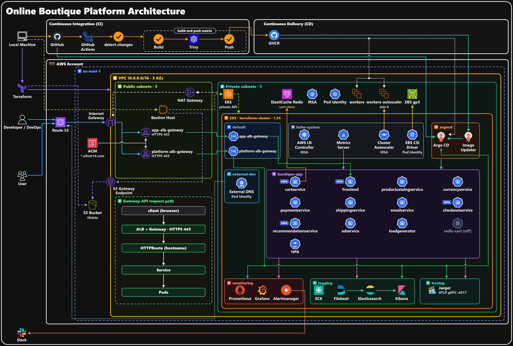
</p>

<p align="center"><sub><b>Figure 1.</b> End-to-end platform: CI on GitHub, GitOps on Argo CD, private EKS, two ALB Gateways, and observability namespaces.</sub></p>

### Control flow

```
Developer  →  GitHub (main)
               │
               ├─ GitHub Actions  →  build / Trivy / push  →  GHCR
               │                                              │
               │                    Argo CD Image Updater  ←──┘
               │                              │
               └──────────────►  Argo CD  ◄───┘
                                      │
                                      ▼
                              boutique-app namespace
```

### Data plane

Internet traffic hits two internet-facing Application Load Balancers created by the AWS Load Balancer Controller from Gateway API `Gateway` objects (`app-alb-gateway` for the shop, `platform-alb-gateway` for Argo CD and observability). External DNS writes Route 53 records from `HTTPRoute` hostnames. Pods run on two managed node groups in **private** subnets. Cart persistence is ElastiCache in those subnets when `connectionString` is set in Git; the chart’s in-cluster Redis stays disabled.

---

## 4. Application architecture

The frontend is the only public HTTP service. Downstream calls are **gRPC**. Checkout orchestrates cart, catalog, payment, shipping, currency, and email.

<p align="center">
  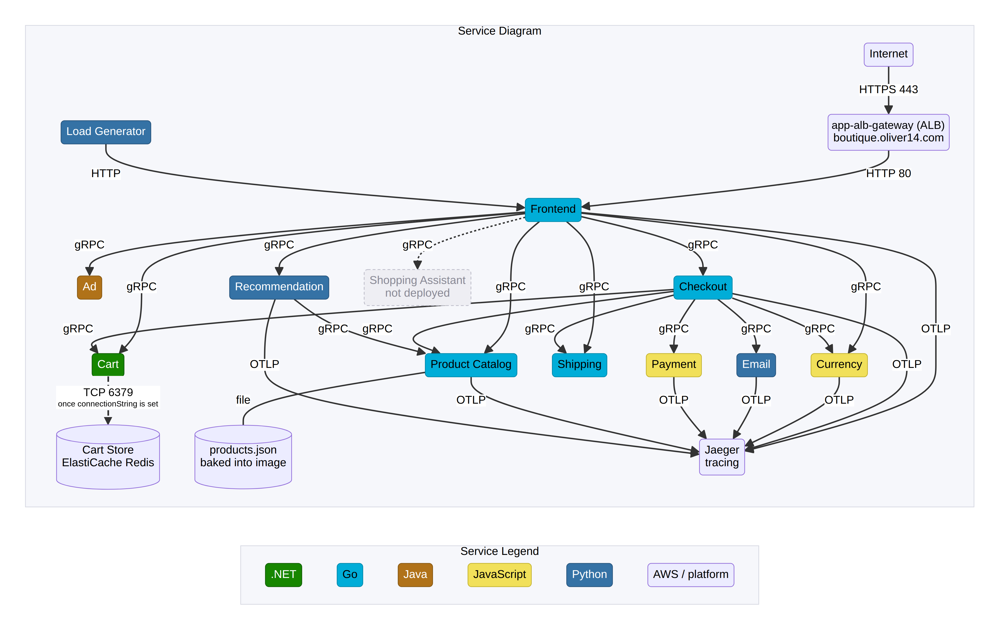
</p>

<p align="center"><sub><b>Figure 2.</b> Service map: HTTPS at <code>boutique.oliver14.com</code>, gRPC between services, Redis for the cart, OTLP traces to Jaeger.</sub></p>

| Service | Language | Role |
| --- | --- | --- |
| **frontend** | Go | HTTP UI and session; fans out to backend services |
| **productcatalogservice** | Go | Product list, search, and product detail |
| **cartservice** | C# / .NET | Shopping cart; Redis on TCP 6379 |
| **checkoutservice** | Go | Place-order orchestration |
| **paymentservice** | Node.js | Simulated card charge; returns a transaction id |
| **shippingservice** | Go | Shipping quote and simulated shipment |
| **currencyservice** | Node.js | Currency conversion |
| **emailservice** | Python | Simulated order confirmation |
| **recommendationservice** | Python | Product recommendations |
| **adservice** | Java | Contextual text ads |
| **loadgenerator** | Python (Locust) | Continuous realistic traffic against the frontend |

Most services are **stateless**. Persistence is intentional and narrow: the cart is the only service that needs a data store. Catalog data is loaded from a JSON file at process start. Payments, shipping, and email are simulated so the platform — CI, GitOps, networking, scaling, observability — stays the focus.

Images are published to GitHub Container Registry under `ghcr.io/oliversims/microservices-demo/<service>` and pulled by the Helm chart that Argo CD renders.

---

## 5. Infrastructure as code

Terraform is split into **21 stacks** instead of one root module. Each stack has its own state, so a change to Alertmanager does not plan the VPC, and destroy order is explicit.

Remote state for stacks after `bootstrap` lives in an encrypted S3 bucket created by that first stack. `bootstrap` keeps local state on the workstation (gitignored). The bastion downloads a copy on first boot so later stacks can resolve the bucket name.

### Apply split

| Where | Stacks | Why |
| --- | --- | --- |
| Workstation | `bootstrap` → `bastion` | State bucket, VPC, hosted zone / ACM, EKS, jump host. After this, the cluster API is private. |
| Bastion | `autoscaling` → `data` | Controllers, GitOps, observability, Metrics Server, ElastiCache. `kubectl` only works here. |

Scripts: `infra/scripts/apply/apply-foundation.sh`, `infra/scripts/apply/apply-addons.sh`, and the matching destroy scripts.

### Stack map

| Stack | Purpose |
| --- | --- |
| `bootstrap` | Versioned, encrypted S3 backend for Terraform state |
| `vpc` | VPC, 3 public + 3 private subnets, NAT, S3 gateway endpoint |
| `route53_acm` | Existing public hosted zone `oliver14.com` and existing wildcard ACM certificate |
| `eks` | Private EKS 1.34, two managed node groups (`workers`, `workers-autoscaler`), OIDC, vpc-cni, Pod Identity |
| `bastion` | Ubuntu jump host, SSH from a fixed IP, cluster-admin access entry |
| `autoscaling` | Cluster Autoscaler on the `workers-autoscaler` node group |
| `alb-controller` | AWS Load Balancer Controller with Gateway API feature gates |
| `gateway-api` | Upstream Gateway API CRDs plus AWS LBC Gateway CRDs |
| `gateway-manifests` | `GatewayClass`, ALB configs, Gateways `app-alb-gateway` and `platform-alb-gateway` |
| `external-dns` | Route 53 records from Gateway `HTTPRoute` hostnames |
| `argocd` | Argo CD, HTTPS UI at `argocd.oliver14.com` |
| `argocd-image-updater` | Watches GHCR `sha-*` tags for boutique apps |
| `kube-prometheus-stack` | Prometheus, Grafana, Alertmanager → Slack |
| `jaeger` | In-cluster OTLP collector and tracing UI |
| `storage` | Dynamic gp3 volumes (`StorageClass` `ebs-aws`) |
| `eck-operator` | Elastic Cloud on Kubernetes operator in `logging` |
| `eck-elasticsearch` | Elasticsearch with a bound PVC |
| `eck-beats` | Filebeat DaemonSet, one pod per node |
| `eck-kibana` | Kibana UI at `kibana.oliver14.com` |
| `metrics` | Resource metrics for HPA and `kubectl top` |
| `data` | Optional AWS Redis for carts (private subnets, cluster SG) |

The boutique application is **not** a Terraform stack. It is applied as an Argo CD `Application` after the platform is healthy.

---

## 6. Networking, DNS, and TLS

North-south traffic uses Kubernetes Gateway API (not Ingress). There are **two** internet-facing ALBs:

- `app-alb-gateway` — `boutique.oliver14.com`
- `platform-alb-gateway` — Argo CD, Grafana, Prometheus, Jaeger, Kibana

| Piece | Role |
| --- | --- |
| `GatewayClass` `aws-alb-gateway-class` | AWS LBC as the Gateway controller |
| `LoadBalancerConfiguration` | Internet-facing scheme, HTTPS :443, ACM cert (one config per Gateway) |
| `Gateway` | Listeners for `*.oliver14.com` |
| `HTTPRoute` | Per-app hostname → ClusterIP Service |
| `TargetGroupConfiguration` | Target type **ip** so the ALB registers pod IPs |
| External DNS | Upsert-only A/AAAA records in the `oliver14.com` zone |

TLS terminates on each ALB. In-cluster UIs behind the platform ALB do not terminate public TLS themselves.

Workers never need a public IP. Egress for images, Helm charts, and AWS APIs goes through NAT. S3 uses a gateway endpoint so state and artifacts do not hairpin to the internet.

---

## 7. Continuous integration

Two workflows implement CI:

- **`ci-trigger.yaml`** — on push to `main` under `services/**`, or manual `workflow_dispatch`. Detects which `services/<service>/` trees changed and fans out a matrix.
- **`microservice-ci.yaml`** — reusable workflow: checkout, Buildx with GitHub Actions cache, Docker build, Trivy (HIGH/CRITICAL), push to GHCR.

Image tag format:

```text
ghcr.io/oliversims/microservices-demo/<service>:sha-<git-sha>
```

Only changed services rebuild. The matrix runs in parallel with `fail-fast: false`, so one failing service does not hide the others.

<table>
  <tr>
    <td align="center" colspan="2">
      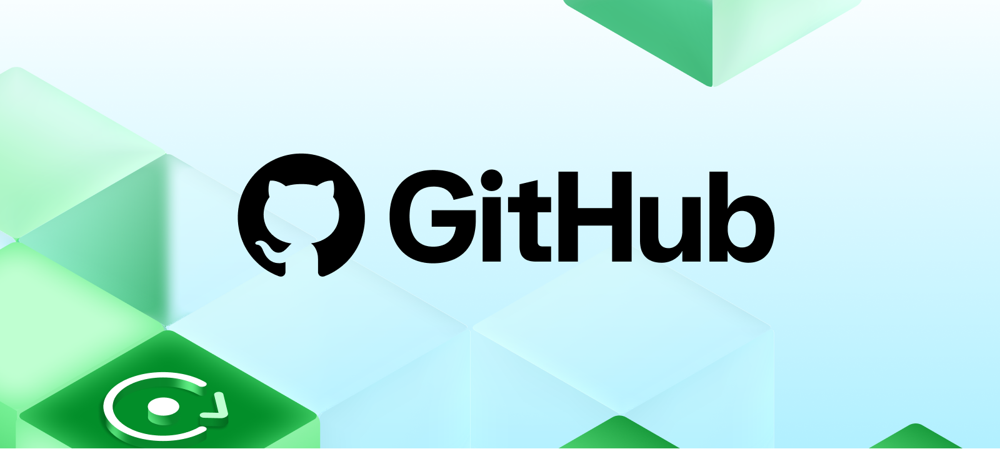
      <br><sub><b>Figure 3.</b> Source of truth: GitHub.</sub>
    </td>
  </tr>
  <tr>
    <td align="center" width="50%">
      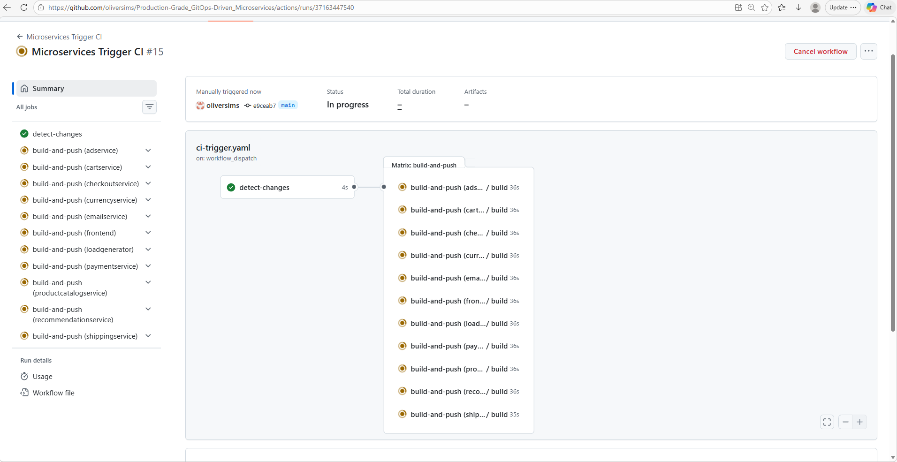
      <br><sub><b>Figure 4.</b> Path-aware CI: <code>detect-changes</code> then a <code>build-and-push</code> matrix.</sub>
    </td>
    <td align="center" width="50%">
      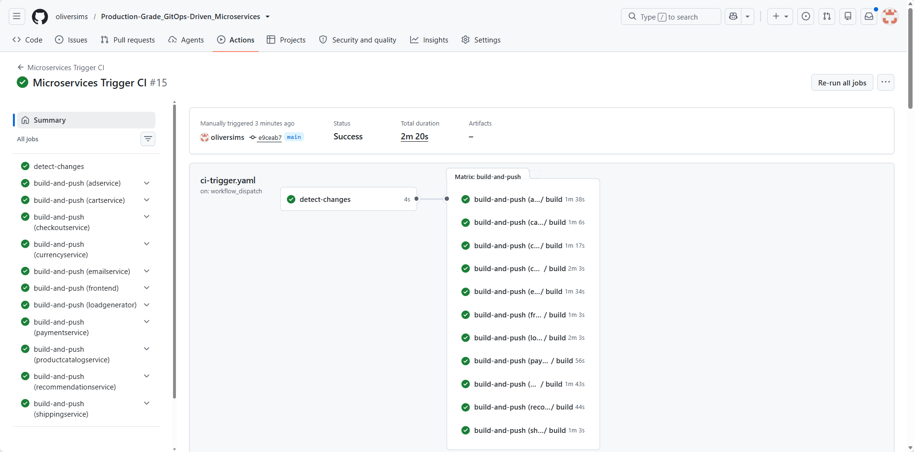
      <br><sub><b>Figure 5.</b> Eleven services green in about two minutes.</sub>
    </td>
  </tr>
</table>

Trivy is part of every image build so vulnerability reports exist before the tag lands in the registry. The pipeline is the promotion path; there is no manual `docker push` in the delivery model.

---

## 8. GitOps continuous delivery

Argo CD is the deployer for Online Boutique. The `Application` `boutique-app` points at the private repository’s `HEAD` and destination namespace `boutique-app`.

Sync policy:

- **automated**
- **prune** — objects removed from Git are removed from the cluster
- **selfHeal** — live drift is reverted to Git

Argo CD does not apply raw Helm alone. `gitops/apps/kustomization.yaml` is the composition layer:

1. Helm chart `onlineboutique` `0.10.4` from `oci://ghcr.io/oliversims`, values in `gitops/apps/values.yaml`
2. Extra manifests for the public route: `HTTPRoute` and `TargetGroupConfiguration` (environment-specific, not chart templates)
3. JSON patches that send OTLP to `jaeger.tracing.svc.cluster.local:4317` and set `OTEL_SERVICE_NAME` per Deployment

That split keeps the chart reusable and keeps AWS Gateway objects next to the app without stuffing them into Helm templates.

**Argo CD Image Updater** watches applications matching `boutique-*`. Strategy `newest-build` with `allowTags: ^sha-[a-f0-9]{7,40}$` picks CI tags and writes them onto the live Application. It does not commit back to Git. GitHub Actions does not rewrite `values.yaml` on every build.

```text
push to main (services/*)
        → CI builds sha-<commit>
        → GHCR
        → Image Updater
        → Argo CD sync
        → new pods in boutique-app
```

<table>
  <tr>
    <td align="center" colspan="2">
      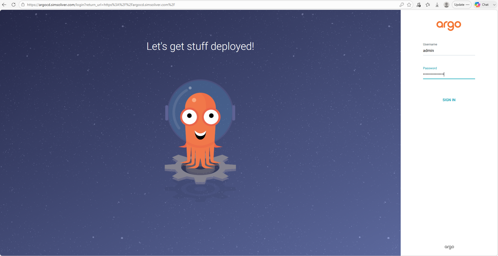
      <br><sub><b>Figure 6.</b> Argo CD sign-in.</sub>
    </td>
  </tr>
  <tr>
    <td align="center" width="50%">
      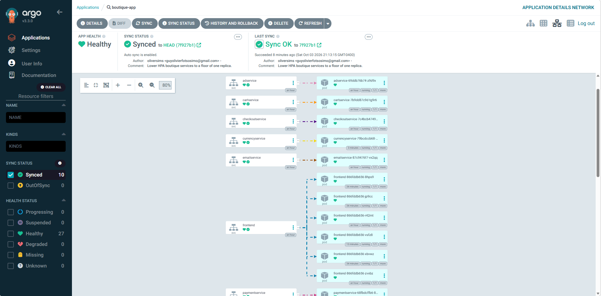
      <br><sub><b>Figure 7.</b> <code>boutique-app</code> Healthy / Synced.</sub>
    </td>
    <td align="center" width="50%">
      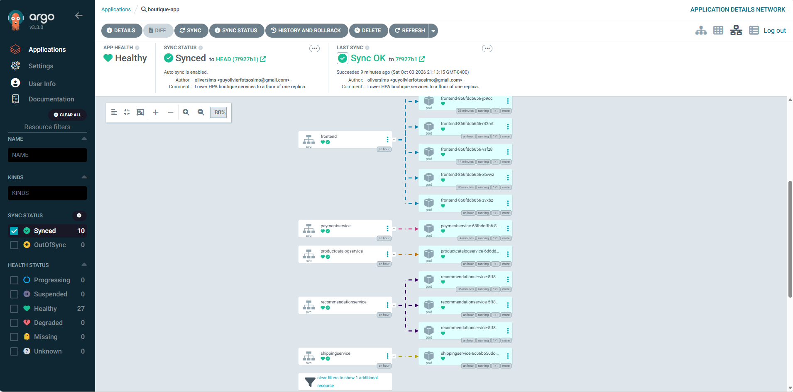
      <br><sub><b>Figure 8.</b> Frontend pods after HPA scale-out.</sub>
    </td>
  </tr>
</table>

Platform components (Prometheus, Elasticsearch, Jaeger, External DNS, the Gateways) stay on Terraform. They are not Argo CD applications, so GitOps credentials for the shop cannot rewrite the observability stack.

---

## 9. Observability

Three pillars, three namespaces, two Gateways (shop vs platform UIs).

| Pillar | Stack | Namespace | Public UI |
| --- | --- | --- | --- |
| Metrics | kube-prometheus-stack | `monitoring` | `grafana.oliver14.com`, `prometheus.oliver14.com` |
| Logs | Elastic Cloud on Kubernetes (operator, Elasticsearch, Filebeat, Kibana) | `logging` | `kibana.oliver14.com` |
| Traces | Jaeger (OTLP gRPC :4317) | `tracing` | `jaeger.oliver14.com` |
| Alerting | Alertmanager → Slack | `monitoring` | Channel `#devops-alerts` |

### 9.1 Grafana

Grafana ships the standard Kubernetes dashboards for the boutique namespace.

<table>
  <tr>
    <td align="center" colspan="2">
      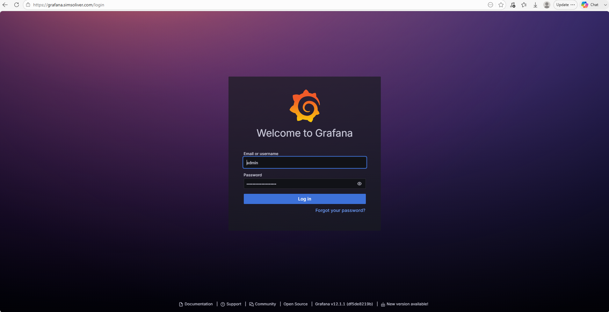
      <br><sub><b>Figure 9.</b> Grafana sign-in.</sub>
    </td>
  </tr>
  <tr>
    <td align="center" width="50%">
      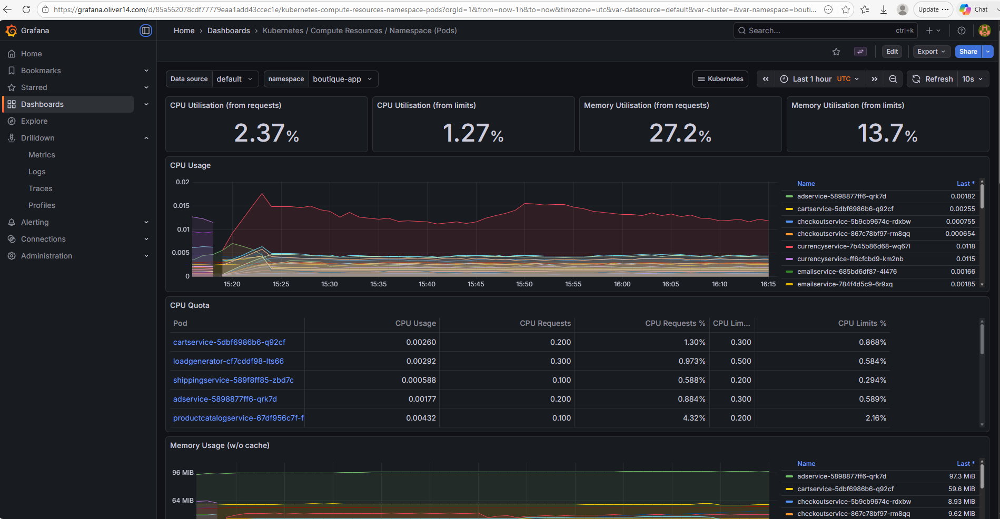
      <br><sub><b>Figure 10.</b> <code>boutique-app</code> CPU and memory.</sub>
    </td>
    <td align="center" width="50%">
      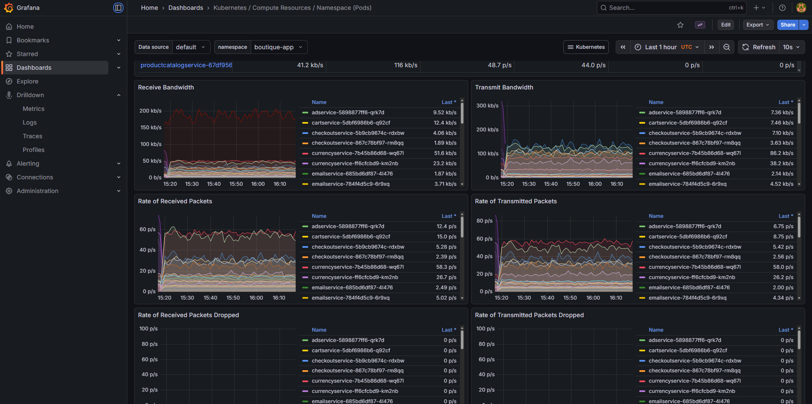
      <br><sub><b>Figure 11.</b> Same dashboard: namespace network receive/transmit.</sub>
    </td>
  </tr>
</table>

### 9.2 Prometheus

Prometheus scrapes kubelet, cAdvisor, CoreDNS, the API server, node-exporter, kube-state-metrics, and the boutique workloads.

<table>
  <tr>
    <td align="center" width="50%">
      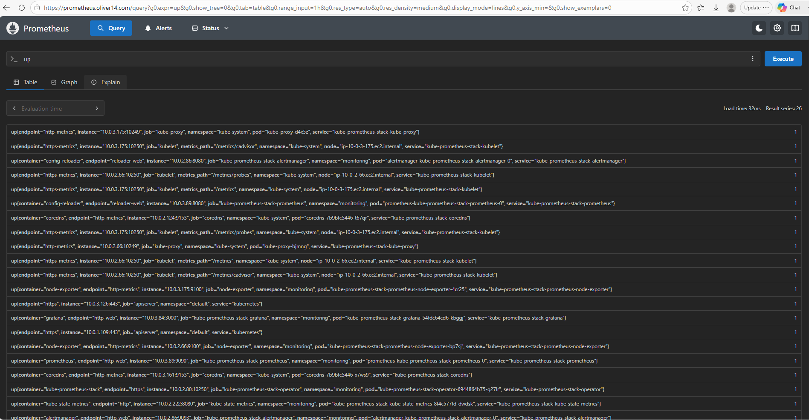
      <br><sub><b>Figure 12.</b> Prometheus <code>up</code> at <code>prometheus.oliver14.com</code>.</sub>
    </td>
    <td align="center" width="50%">
      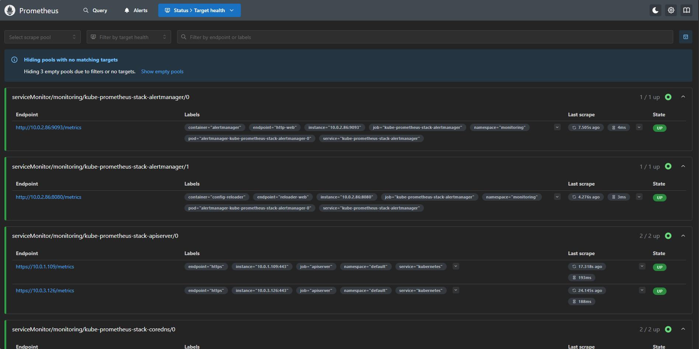
      <br><sub><b>Figure 13.</b> Scrape pools UP (API server, CoreDNS, Alertmanager).</sub>
    </td>
  </tr>
</table>

### 9.3 Logging

Filebeat runs as a DaemonSet (Elastic Cloud on Kubernetes Beat), reads container logs from the node, and ships them to Elasticsearch on an EBS-backed volume. Kibana Discover is filtered by Kubernetes labels (`kubernetes.labels.app`, namespace, pod).

<table>
  <tr>
    <td align="center" colspan="2">
      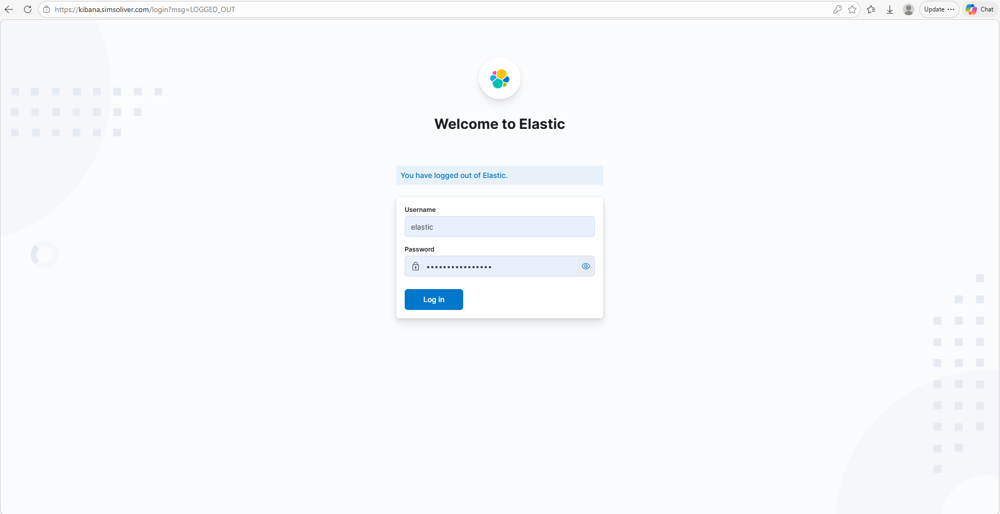
      <br><sub><b>Figure 14.</b> Kibana sign-in.</sub>
    </td>
  </tr>
  <tr>
    <td align="center" width="50%">
      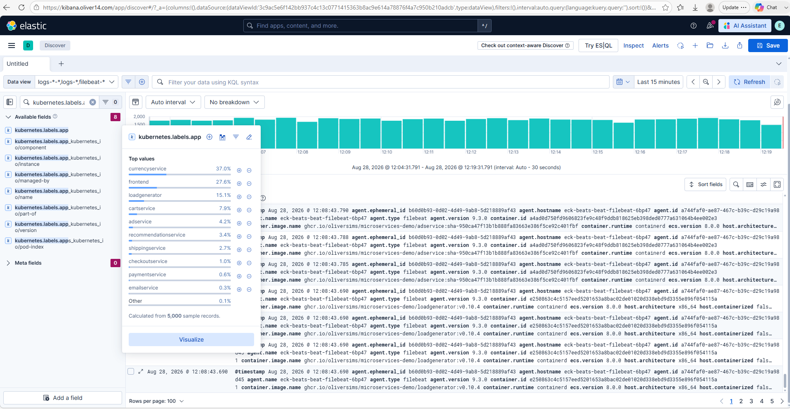
      <br><sub><b>Figure 15.</b> Log share by <code>kubernetes.labels.app</code>.</sub>
    </td>
    <td align="center" width="50%">
      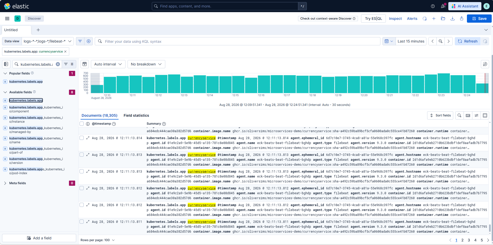
      <br><sub><b>Figure 16.</b> Filtered to <code>currencyservice</code>.</sub>
    </td>
  </tr>
</table>

### 9.4 Distributed tracing

Boutique Deployments are patched so traces export over OTLP to Jaeger in-cluster (not through a public ALB). `OTEL_SERVICE_NAME` is set per service so the Jaeger service dropdown lists `frontend`, `checkoutservice`, `paymentservice`, and so on — not a single `unknown_service`.

<table>
  <tr>
    <td align="center" width="50%">
      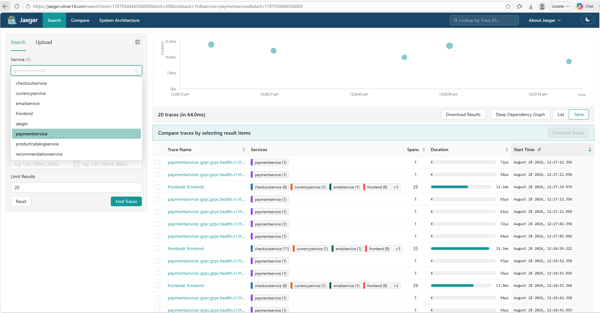
      <br><sub><b>Figure 17.</b> Jaeger: traces across boutique services.</sub>
    </td>
    <td align="center" width="50%">
      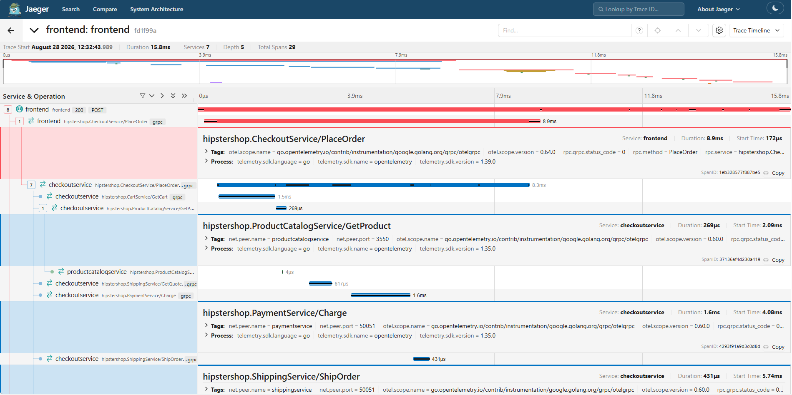
      <br><sub><b>Figure 18.</b> One checkout: frontend → catalog, payment, shipping.</sub>
    </td>
  </tr>
</table>

### 9.5 Alerting

Alertmanager groups by namespace and sends **firing** and **resolved** notifications to Slack. The webhook URL is a Kubernetes Secret created from a gitignored file on the bastion — it is never committed.

<table>
  <tr>
    <td align="center" width="50%">
      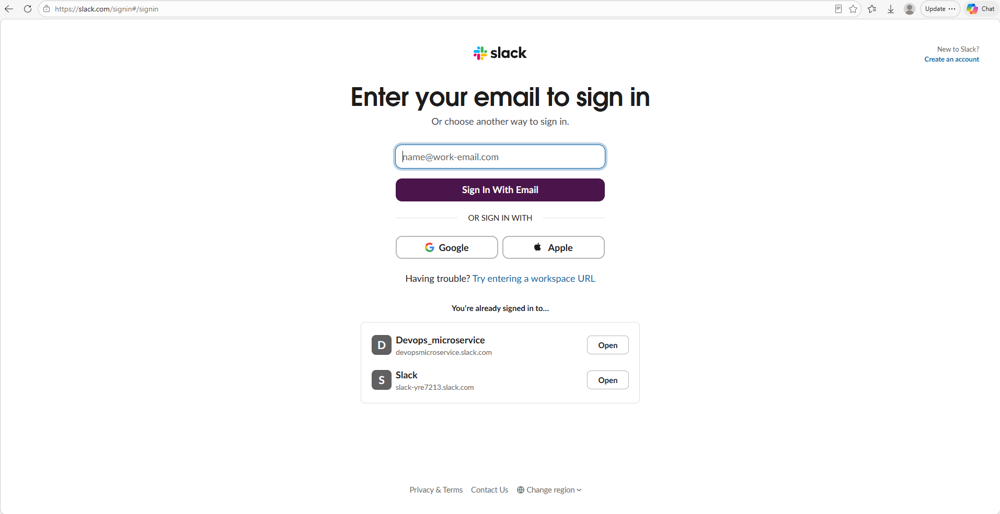
      <br><sub><b>Figure 19.</b> Slack workspace for Alertmanager.</sub>
    </td>
    <td align="center" width="50%">
      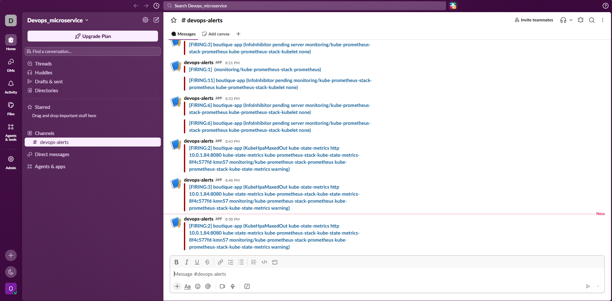
      <br><sub><b>Figure 20.</b> <code>#devops-alerts</code> FIRING for <code>boutique-app</code>.</sub>
    </td>
  </tr>
</table>

---

## 10. Autoscaling and reliability

| Layer | Mechanism |
| --- | --- |
| Nodes | Cluster Autoscaler on the `workers-autoscaler` node group; `workers` holds the desired baseline |
| Pods | Git-managed HPAs for **frontend**, **cartservice**, **checkoutservice**, **recommendationservice** (floor 1, max 6) |
| Traffic | In-cluster **loadgenerator** (Locust) against the frontend |
| Metrics API | Metrics Server (`kubectl top`, HPA CPU) |

HPA objects are Git-managed. A `kubectl edit` of replica counts is reverted by Argo CD on the non-HPA services. The four HPA Deployments ignore `/spec/replicas` so scale-out is not marked OutOfSync.

HPA CPU targets are set so the in-cluster Locust loadgenerator can demonstrate scale-out. A production threshold would follow real SLOs, not a demo of the controller.

---

## 11. Security posture

| Control | Implementation |
| --- | --- |
| Cluster API | Private endpoint; identity security group allow-lists the bastion only |
| Workers | Private subnets, no public node IPs |
| Identity | IRSA for Cluster Autoscaler and LBC; Pod Identity for External DNS and EBS CSI |
| TLS | ACM wildcard `oliver14.com` / `*.oliver14.com` on both ALBs |
| Images | Built in CI, stored in GHCR, scanned with Trivy before push |
| Secrets | Slack webhook and Terraform state stay out of Git; PEM keys gitignored |
| RBAC blast radius | Application GitOps cannot mutate the monitoring/logging Terraform releases |
| Network | Default VPC security group deny-all; the ALBs and the bastion are the public surfaces |

The bastion is the operational choke point: SSH from a known IP, then `kubectl` to the private API. There is no public Kubernetes endpoint to scrape or brute-force.

---

## 12. Repository layout

The private repository is laid out as follows. This public repository holds the README, `docs/architecture/`, and `docs/evidence/`.

```text
.
├── .github/workflows/          CI trigger + reusable image build
├── services/                   Boutique microservice source
├── proto/                      Shared gRPC contract
├── gitops/
│   ├── apps/                   Argo CD source (Helm values, HTTPRoute, HPAs)
│   └── control-plane/          Application + ImageUpdater CRs
├── infra/
│   ├── bootstrap/              state bucket (local tfstate)
│   ├── foundation/             vpc → bastion
│   ├── addons/                 ingress, GitOps, observability, storage
│   ├── data/                   ElastiCache Redis
│   ├── modules/
│   └── scripts/                apply/ and destroy/
└── docs/
    ├── architecture/
    ├── operations/             restore.md, teardown.md
    └── evidence/
```

---

## 13. Public hostnames

These names are what the platform publishes when it is applied. **They are not live.** The AWS infrastructure was destroyed after the last run to avoid ongoing cost. A recruiter clicking them should expect DNS or TLS failure, not a broken project.

| Surface | Hostname (when applied) |
| --- | --- |
| Storefront | https://boutique.oliver14.com |
| Argo CD | https://argocd.oliver14.com |
| Grafana | https://grafana.oliver14.com |
| Prometheus | https://prometheus.oliver14.com |
| Jaeger | https://jaeger.oliver14.com |
| Kibana | https://kibana.oliver14.com |

Credentials for Grafana, Argo CD, and Kibana come from Terraform outputs or in-cluster Secrets — never from this README. Screenshots of those UIs are in sections 7–9 and 15.

---

## 14. Operations

Bring-up and tear-down are documented as ordered runbooks in the private repository, not as a single `terraform apply` at the repo root. The current AWS account is in the torn-down state (cost). Restore rebuilds the same topology from that repository.

| Document | Use |
| --- | --- |
| `docs/operations/restore.md` | Workstation `bootstrap` → `bastion`, bastion `autoscaling` → `data`, then boutique Application |
| `docs/operations/teardown.md` | Delete boutique first, destroy addons on the bastion, then foundation and bootstrap on the workstation |

Typical restore sequence:

1. Run `infra/scripts/apply/apply-foundation.sh` on the workstation. After bootstrap, copy `state_bucket_name` into later stack backends, then continue.
2. SSH to the bastion, wait for cloud-init, then `infra/scripts/apply/apply-addons.sh`.
3. `kubectl apply -f gitops/control-plane/boutique-app.yaml` (HPAs are in the Application).
4. Confirm DNS and TLS on the six hostnames above.

Destroy is the reverse: GitOps app and namespace first, then add-on stacks on the bastion, then foundation and bootstrap on the workstation. The ALBs and their security groups must be gone before VPC destroy, which is why Gateway stacks are destroyed while the cluster API is still reachable from the bastion.

---

## 15. Evidence from the running platform

Captured while the AWS platform was running, before it was torn down for cost. CI, GitOps, and observability screenshots are in sections 7–9; this section is the storefront and the cluster.

### Storefront

<table>
  <tr>
    <td align="center" colspan="2">
      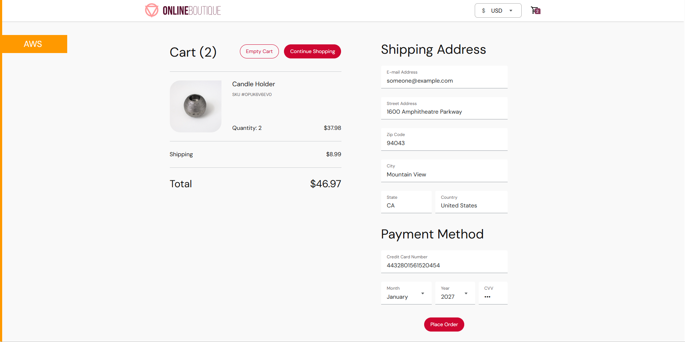
      <br><sub><b>Figure 21.</b> Checkout.</sub>
    </td>
  </tr>
  <tr>
    <td align="center" width="50%">
      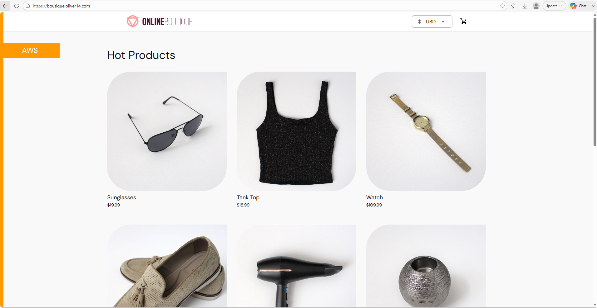
      <br><sub><b>Figure 22.</b> Storefront at <code>boutique.oliver14.com</code>.</sub>
    </td>
    <td align="center" width="50%">
      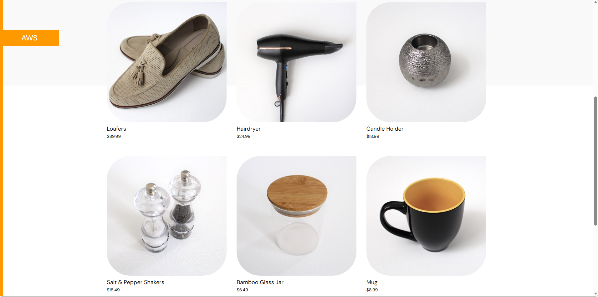
      <br><sub><b>Figure 23.</b> Product catalog.</sub>
    </td>
  </tr>
</table>

### Amazon EKS

<table>
  <tr>
    <td align="center" width="50%">
      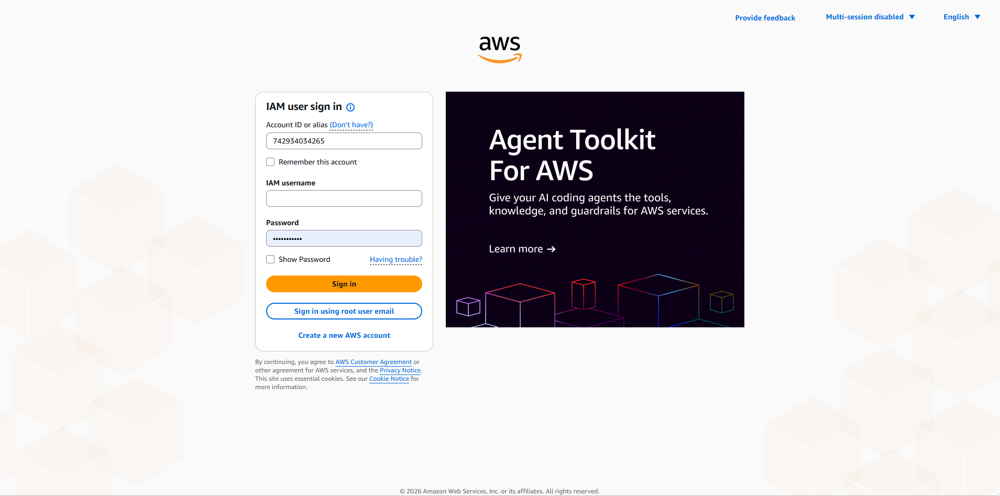
      <br><sub><b>Figure 24.</b> AWS IAM sign-in.</sub>
    </td>
    <td align="center" width="50%">
      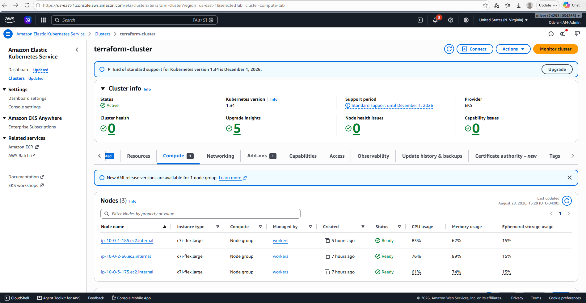
      <br><sub><b>Figure 25.</b> <code>terraform-cluster</code> 1.34, Active.</sub>
    </td>
  </tr>
</table>

<table>
  <tr>
    <td align="center" width="33%">
      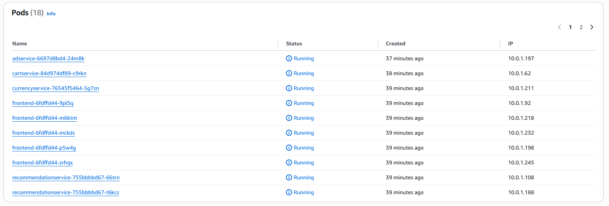
      <br><sub><b>Figure 26.</b> Boutique workloads Running.</sub>
    </td>
    <td align="center" width="33%">
      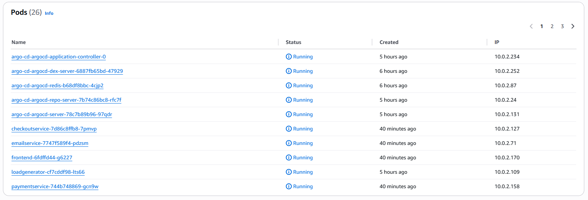
      <br><sub><b>Figure 27.</b> Argo CD and boutique pods.</sub>
    </td>
    <td align="center" width="33%">
      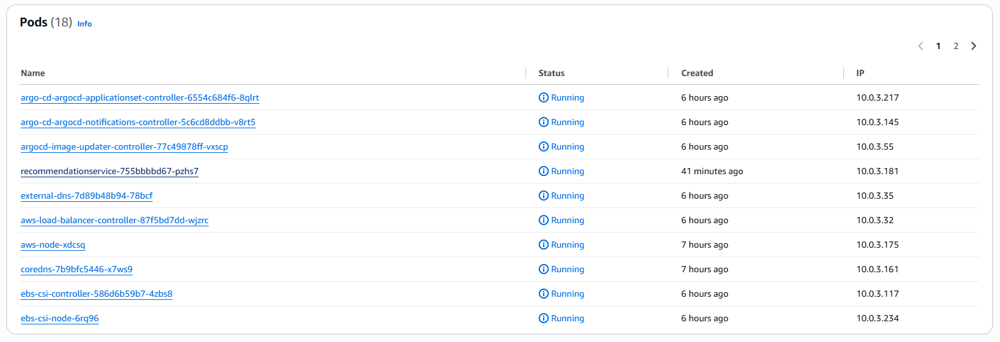
      <br><sub><b>Figure 28.</b> LBC, External DNS, EBS CSI, Image Updater.</sub>
    </td>
  </tr>
</table>

---

## 16. Design notes

**Why Gateway API instead of Ingress.** Each product adds an `HTTPRoute`. The shop and the platform UIs use separate `Gateway` objects (two ALBs) so shop traffic and operator UIs do not share one load balancer. AWS still needs `TargetGroupConfiguration` because ALB target type is not a native Kubernetes field.

**Why two node groups.** `workers` holds the desired baseline. `workers-autoscaler` is the scale-out pool (min 0) so Cluster Autoscaler can add and drain capacity without rewriting the baseline group’s desired count.

**Why Terraform for the platform and GitOps for the app.** Cluster add-ons, IAM, and DNS are slow-moving and privileged. The shop should ship at commit speed. Splitting those planes keeps a bad Application sync from rewriting Prometheus or a Gateway.

**Why a bastion.** A private EKS API is the correct default. The bastion is an SSH-gated admin host inside the VPC, bootstrapped with kubeconfig and the bootstrap state object.

**Why `sha-*` tags.** The Git commit is the image identity. Image Updater selects the newest matching tag on GHCR without moving a mutable `latest` tag, and without committing `values.yaml` on every build.

**Why destroy after a demo.** EKS, NAT gateways, ALBs, and EBS volumes keep billing while idle. Ordered teardown is part of the operating model: prove the platform, capture evidence, then take the account back to near-zero compute cost. The hosted zone and ACM certificate stay; they are not created by this project.
